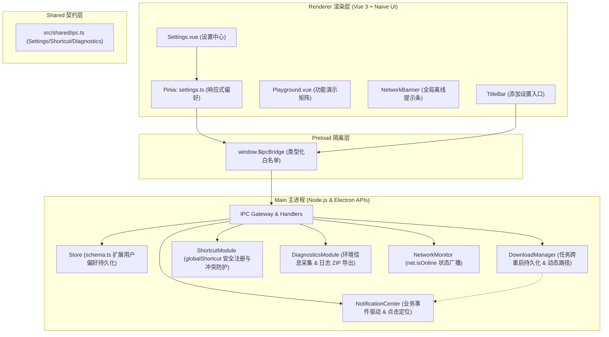

# Technical Design: Commercial Settings Center & Advanced Desktop Features

## Architecture Overview

在现有的分层架构（`src/main`、`src/preload`、`src/renderer`、`src/shared`）下，本设计遵循 **单一职责、最小特权暴露、沙箱隔离** 的设计原则，扩展桌面特有服务与商业化 UI 呈现体系。



## Detailed Module Design

### 1. 配置 Schema 与存储层 (`src/main/modules/store/`)

- 扩展 `AppSettings` 结构体：
  ```typescript
  export interface UserSettings {
    general: {
      language: "zh-CN" | "en-US";
      theme: "system" | "dark" | "light";
      closeAction: "tray" | "quit";
      autoStart: boolean;
    };
    download: {
      defaultDirectory: string;
      maxConcurrency: number;
      autoResumeOnStart: boolean;
    };
    notification: {
      enabled: boolean;
      sound: boolean;
      onDownloadComplete: boolean;
      onUpdateReady: boolean;
    };
    shortcut: {
      toggleWindow: string; // 默认 'CommandOrControl+Shift+X'
    };
  }
  ```
- 保证旧版本 `current.json` 自动通过 `migrateSettings` 安全升级并填补缺省值。

### 2. 下载管理器状态持久化 (`src/main/modules/download/`)

- 将未终结任务（`state: queued | started | progress | paused`）元数据异步同步至 `store.get('downloadTasks')`。
- 在 `startup` 过程中扫描未终结任务，将其恢复为可续传状态，并在渲染进程发起下载前允许更新目标路径。

### 3. 通知与业务联动 (`src/main/modules/notification/`)

- 扩展 `notify(options)` 支持 `onClick` 回调动作。
- 当下载任务 `state === 'completed'` 且用户启用了 `notification.onDownloadComplete` 时，发送系统通知。
- 用户点击通知时，执行 `shell.showItemInFolder(task.savePath)`，若主窗口最小化则唤醒恢复。

### 4. 诊断信息与日志压缩 (`src/main/modules/system/diagnostics.ts`)

- 采集脱敏元数据：
  - 系统信息：OS 版本、架构、Node/Electron/Chrome/V8 版本、内存占用；
  - 最近 7 天的 `main.log` 日志文件，执行敏感凭据过滤（脱敏已在 `log-redaction` 中实现）；
- 使用 `fflate.zipSync` 打包并在主进程弹出 `dialog.showSaveDialog` 供用户导出。

### 5. 全局快捷键模块 (`src/main/modules/system/shortcut-module.ts`)

- 提供 `registerShortcut(accelerator: string, callback: () => void): boolean`；
- 在注册新快捷键前注销旧快捷键；
- 窗口隐藏/最小化到托盘时，按下该快捷键自动显示并激活窗口。

### 6. 前端 UI 设计 (`src/renderer/views/Settings.vue`)

- 左侧 Naive UI `NTabs` (vertical) 或分段导航：
  1. `常规 (General)`：图标 `<DesktopOutline>`，配置语言、主题（单选卡片带预览效果）、退出行为、自启动；
  2. `下载 (Downloads)`：图标 `<DownloadOutline>`，路径输入框带浏览按钮、并发滑块（带刻度）、自动续传开关；
  3. `通知 (Notifications)`：图标 `<NotificationsOutline>`，开关组、测试弹窗按钮；
  4. `快捷键 (Shortcuts)`：图标 `<KeypadOutline>`，快捷键录制组件、恢复默认；
  5. `系统与诊断 (Diagnostics)`：网络状态卡片、环境参数列表、一键导出日志按钮；
  6. `关于 (About)`：应用 Logo、版本、GitHub 链接、协议与构建信息。
- 顶部标题栏 `TitleBar.vue` 增加设置图标，点击路由跳转至 `/settings`。

## Verification Strategy

1. **单元测试与集成测试**：
   - `tests/settings-schema.test.ts`：测试新增设置项的默认值、范围约束与坏损容错。
   - `tests/download-persistence.test.ts`：测试任务序列化、反序列化与重启恢复逻辑。
   - `tests/diagnostics-archive.test.ts`：测试系统诊断打包与日志脱敏安全性。
   - `tests/shortcut-policy.test.ts`：测试快捷键按键解析与注销机制。
2. **自动化构建与类型安全**：
   - 运行 `pnpm check`（0 Lint/Type error）与 `vue-tsc --noEmit`。
   - 运行全量 `pnpm test`。
