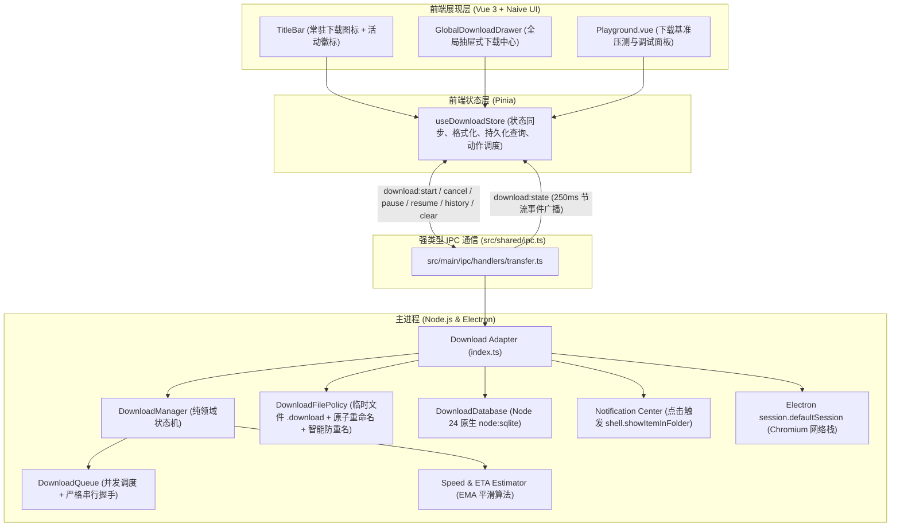

# Design: Download Feature Optimization and Architecture Encapsulation

## 1. 架构总览与分层边界 (Architecture & Boundaries)



---

## 2. 数据库设计 (SQLite Schema via `node:sqlite`)

采用 Node 24 原生 `node:sqlite`（`DatabaseSync`），无任何额外二进制依赖，存储路径为 `app.getPath("userData")/downloads.db`。

```sql
CREATE TABLE IF NOT EXISTS downloads (
  id TEXT PRIMARY KEY,
  url TEXT NOT NULL,
  filename TEXT NOT NULL,
  save_path TEXT NOT NULL,
  total_bytes INTEGER DEFAULT 0,
  received_bytes INTEGER DEFAULT 0,
  state TEXT NOT NULL,          -- 'queued', 'started', 'progress', 'paused', 'interrupted', 'completed', 'cancelled', 'failed'
  can_resume INTEGER DEFAULT 0,  -- 0 or 1
  error_message TEXT,
  created_at INTEGER NOT NULL,  -- timestamp ms
  updated_at INTEGER NOT NULL,  -- timestamp ms
  completed_at INTEGER          -- timestamp ms
);

CREATE INDEX IF NOT EXISTS idx_downloads_created_at ON downloads(created_at DESC);
CREATE INDEX IF NOT EXISTS idx_downloads_state ON downloads(state);
```

---

## 3. IPC 契约扩展 (`src/shared/ipc.ts`)

```typescript
export interface DownloadState {
  id: string;
  url: string;
  state:
    | "queued"
    | "started"
    | "progress"
    | "paused"
    | "interrupted"
    | "completed"
    | "cancelled"
    | "failed";
  filename?: string;
  percent?: number; // 0 - 100
  receivedBytes?: number; // 已下载字节
  totalBytes?: number; // 总字节数
  speed?: number; // 平滑速度 (bytes/s)
  eta?: number; // 预计剩余时间 (秒)
  canResume?: boolean; // 是否支持断点续传
  path?: string; // 最终文件路径
  error?: string; // 错误原因
  createdAt?: number;
  completedAt?: number;
  fileExists?: boolean; // 针对历史记录：本地文件是否存在
}

export interface DownloadHistoryQuery {
  limit?: number;
  offset?: number;
  state?: DownloadState["state"];
}
```

**新增 IPC 通道**：

- `download:history:get`: `(query?: DownloadHistoryQuery) => Promise<DownloadState[]>`
- `download:history:remove`: `(id: string) => Promise<boolean>`
- `download:history:clear`: `() => Promise<number>`
- `download:file:show`: `(path: string) => Promise<void>`
- `download:file:open`: `(path: string) => Promise<void>`

---

## 4. 核心机制与算法设计 (Key Algorithms)

### 4.1 主进程 IPC 节流调度（250ms 窗口）

```typescript
interface TaskThrottle {
  lastEmit: number;
  timer?: NodeJS.Timeout;
  pendingState?: DownloadState;
}

// 调度逻辑：
// 1. 若 state !== 'progress'（状态变更），清除挂起 timer，立即广播，重置 lastEmit。
// 2. 若 state === 'progress'：
//    若 now - lastEmit >= 250ms，立即广播并更新 lastEmit = now。
//    若 now - lastEmit < 250ms，缓存 pendingState，若无 timer 则启动 timer 在 (250 - (now - lastEmit)) ms 后执行广播。
```

### 4.2 指数移动平均 (EMA) 速度与 ETA 算法

$$v_{\text{inst}} = \frac{\text{receivedBytes} - \text{prevBytes}}{\Delta t}$$
$$v_{\text{smooth}} = 0.3 \cdot v_{\text{inst}} + 0.7 \cdot v_{\text{prev\_smooth}}$$
$$\text{ETA} = \begin{cases} \lceil \frac{\text{totalBytes} - \text{receivedBytes}}{v_{\text{smooth}}} \rceil & \text{if } v_{\text{smooth}} > 0 \land \text{totalBytes} > \text{receivedBytes} \\ \text{undefined} & \text{otherwise} \end{cases}$$

### 4.3 临时文件与防冲突原子重命名 (`DownloadFilePolicy`)

1. **生成路径**：
   - 解析并清理文件名：`safeName = sanitize(filename) || "download"`；
   - 目标路径初始值：`targetPath = path.join(downloadDir, safeName)`；
   - 冲突检测与序号追加：若存在同名文件，寻找首个不存在的 `safeName (i).ext` 作为 `finalPath`；
   - 临时文件路径：`tempPath = finalPath + ".download"`；
2. **下载落盘**：`item.setSavePath(tempPath)`；
3. **完成落盘**：`await fs.promises.rename(tempPath, finalPath)`；
4. **异常或取消**：`await fs.promises.unlink(tempPath).catch(() => {})`。

### 4.4 网络中断（Interrupted）与手动恢复

1. 捕获 `item.on('updated')` 中的 `state === 'interrupted'`；
2. 状态机切入 `interrupted`，记录 `canResume = item.canResume()`，保存当前已接收字节数；
3. **严格不执行自动重试**，广播 `interrupted` 给渲染进程，UI 展示“网络中断，请点击恢复”；
4. 用户在界面点击“恢复”时：
   - 若 `canResume === true`，调用 `item.resume()`；
   - 若 `canResume === false` 或 item 已不可用，提示用户将从头重新发起任务。

---

## 5. UI 组件与前端架构设计

1. **`GlobalDownloadDrawer.vue` (全局下载抽屉)**：
   - 顶部：下载总览（进行中数量、总下载速度、一键暂停所有/清空已完成）；
   - 列表：
     - 进行中任务卡片：文件名、动态进度条、已下载/总大小、速度与 ETA、暂停/继续/取消按钮；
     - 中断/失败任务卡片：错误或中断提示、重试/恢复按钮；
     - 已完成历史卡片：完成时间、文件大小、“打开文件”、“在访达/资源管理器中显示”、删除记录按钮。如果文件被外部删除，置灰并显示“文件已失效”。
2. **`TitleBar.vue` 下载入口图标**：
   - 动态数字徽标：正在下载的任务数；
   - 悬浮提示与点击开关抽屉。
