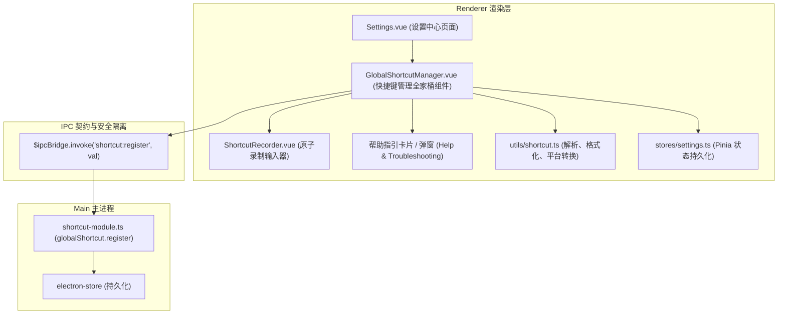

# 技术设计: 全局快捷键独立组件化与帮助指引

## 1. 架构分层设计

## 2. 模块细化设计

### 2.1 工具函数 `src/renderer/utils/shortcut.ts`

- `parseKeyboardEvent(e: KeyboardEvent): { valid: boolean; accelerator: string; error?: string }`
  - 拦截单修饰键；
  - 拦截仅单字母（如单独一个 `A`），必须至少带有 `Ctrl` / `Cmd` / `Alt`；
  - 统一映射为 `CommandOrControl` 或相应标准键名。
- `formatAcceleratorDisplay(accelerator: string, isMac?: boolean): string[]`
  - 将 `CommandOrControl+Shift+X` 解析为按键数组，如 Mac 上输出 `["⌘", "⇧", "X"]`，Windows 上输出 `["Ctrl", "Shift", "X"]`。
- `validateAccelerator(accelerator: string): boolean`
  - 正则或语法校验。

### 2.2 原子录制组件 `src/renderer/components/ShortcutRecorder.vue`

- **Props**:
  - `modelValue: string`: 当前绑定的 Accelerator 字符串；
  - `disabled?: boolean`;
  - `placeholder?: string`;
- **Emits**:
  - `update:modelValue(val: string)`
  - `change(val: string)`
  - `recording-change(isRecording: boolean)`
- **交互状态**:
  - `isRecording`: 是否正在录制；
  - `tempKeys`: 正在按下的修饰键临时数组；
  - 按下 `Escape` 取消录制并恢复原值；
  - 聚焦与失焦处理。

### 2.3 业务包装组件 `src/renderer/components/GlobalShortcutManager.vue`

- 聚合了：
  1. 功能标题与使用说明；
  2. 录制组件集成；
  3. “恢复默认快捷键”快捷动作；
  4. 注册状态与冲突检测红显（接收 IPC 注册返回值，若冲突则显示明确错误及回滚）；
  5. **快捷键帮助引导中心**（包含：键位符号说明、排查指南、系统冲突原因剖析、一键预设推荐等）。

### 2.4 设置页面接入 `src/renderer/views/Settings.vue`

- 将原有的 `n-input` 替换为 `<GlobalShortcutManager v-model="form.globalShortcutToggle" />`。
- 保持与 `SettingsStore` 和 `saveForm()` 的双向响应。

## 3. 测试与验证策略

- 单元测试：`tests/shortcut-recorder.test.ts`
  - 测试按键事件到 Accelerator 的正确映射；
  - 测试缺少修饰键时的拦截行为；
  - 测试跨平台按键显示转换；
  - 测试特殊按键（F1-F12、方向键、标点符号）。
- 质量门禁：`pnpm check` + `pnpm typecheck:vue` + `pnpm test`。
