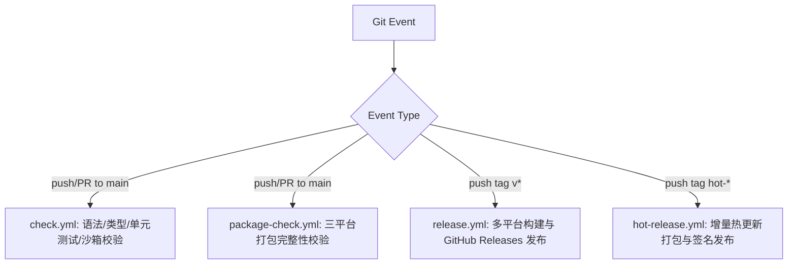

# Technical Design: 架构与交互设计方案

## 1. 整体架构与模块边界 (Architecture)

### 1.1 GitHub Actions 工作流精简方案



- **删除**: `.github/workflows/publish-manual-test.yml`（硬编码死代码）。
- **优化**: 将 `build-and-release.yml` 规范命名并整合为统一的 `release.yml`，保留可选的私钥签名校验与免签名容错发布机制，避免无证书时 GitHub Actions 报错崩溃。

---

### 1.2 顶栏结构与子功能导航迁移设计

在 `src/renderer/components/TitleBar.vue` 中重新规划左右布局：

```
+-------------------------------------------------------------------------------------------------------+
|  [ macOS 交通灯 ]  [应用标题: electron-vue-template]  |  [ 首页 | 窗口控制 | 数据传输 | 应用升级 | 设置 ]  |  [ 拖拽区 ]  [下载 | 主题 | 语言 | 窗口按钮]  |
+-------------------------------------------------------------------------------------------------------+
```

- **应用标题展示**：
  - macOS 端：不再隐藏标题，放置在原生交通灯占位区右侧，配以现代质感的品牌徽标与文字 `electron-vue-template`。
  - Windows / Linux / Web 端：放置在最左侧。
- **顶栏导航项定义**：
  ```ts
  const navItems = computed(() => [
    { path: "/", label: t("header.nav.home") },
    { path: "/playground", query: { tab: "window" }, label: t("header.nav.window") },
    { path: "/playground", query: { tab: "transfer" }, label: t("header.nav.transfer") },
    { path: "/playground", query: { tab: "update" }, label: t("header.nav.update") },
    { path: "/settings", label: t("header.nav.settings") },
  ]);
  ```
- **Playground 响应联动**：
  `Playground.vue` 监听 `route.query.tab`，当顶部导航切换时自动切换至对应 `activeTab`；同时保持内部控制台与各子组件的完整性。

---

### 1.3 VS Code 风格快捷键管理设计

#### 数据结构与存储契约

在 `src/renderer/stores/shortcut.ts` 或扩展设置中定义统一的快捷键模型：

```ts
export interface ShortcutItem {
  id: string; // 命令唯一标识，如 "app.settings", "app.toggleWindow"
  command: string; // 国际化或中文名称，如 "打开偏好设置"
  accelerator: string; // 当前按键，如 "CommandOrControl+,"
  defaultAccelerator: string; // 默认键位
  scope: "global" | "local"; // 作用域：全局系统热键 或 应用内快捷键
  when?: string; // 生效条件说明，如 "应用内聚焦时" 或 "全局桌面"
}
```

#### UI 表现与编辑交互（参考用户上传截图）

- **表格列设计**：
  1. `命令 (Command)`：展示命令图标与名称、生效条件。
  2. `键绑定 (Keybinding)`：未编辑态渲染为现代质感的 `<kbd>` 胶囊按键标签；编辑态渲染为包含捕获器（输入框）的录制控件。
  3. `作用域 / 当 (When)`：清晰标明 `全局` 或 `应用激活时`。
  4. `操作 (Actions)`：
     - 未编辑态：【编辑】（铅笔图标）；
     - 编辑态：【确定 / 修改】（勾选）、【重置为默认】（旋转撤销箭头）、【取消】（叉号）。

#### 事件注册与生效机制

1. **全局快捷键 (Global)**：通过现有的 `window.$ipcBridge.invoke("shortcut:register", accelerator)` 向 Electron 主进程动态注册并持久化到 Store。
2. **应用内快捷键 (Local)**：在 Vue 顶层注入全局 `window.addEventListener("keydown", handler)` 事件监听，当用户按下对应按键时触发路由跳转（如进入偏好设置）或切换抽屉/主题。
