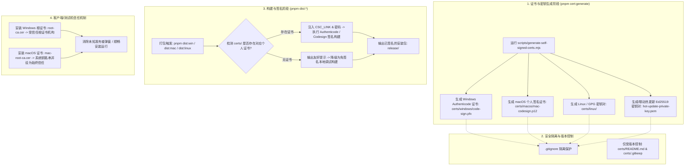

# Technical Design: 三端个人证书体系与构建签名集成架构

## 1. 整体架构与流程 (Architecture & Flow)



---

## 2. 证书文件组织规范 (Directory Layout)

在项目根目录下建立规范化的 `certs/` 目录结构：

```text
certs/
├── .gitkeep                      # 保持目录结构
├── README.md                     # 证书使用指南与安装指引
├── windows/                      # Windows 代码签名目录 (受 .gitignore 保护)
│   ├── root-ca.cer               # 供客户端安装信任的公钥根证书
│   ├── code-sign.pfx             # 包含私钥的代码签名证书（用于打包签名）
│   └── cert-info.json            # 证书元数据（颁发者、有效期、SHA1/SHA256指纹）
├── macos/                        # macOS 代码签名目录 (受 .gitignore 保护)
│   ├── mac-root-ca.cer           # 供本地系统钥匙串信任的公钥证书
│   ├── mac-codesign.p12          # 包含私钥的个人证书包
│   └── cert-info.json            # 证书元数据
└── linux/                        # Linux 签名目录 (受 .gitignore 保护)
    ├── public.key                # GPG 公钥
    ├── private.key               # GPG 私钥
    └── cert-info.json            # 密钥指纹与信息
```

---

## 3. 技术实现细节与跨平台兼容方案 (Implementation Details)

### 3.1 生成脚本设计 (`scripts/generate-self-signed-certs.mjs`)

- **跨平台技术选型**：
  采用 Node.js 原生 `crypto` 模块或轻量 `node-forge` / 调用系统内置 `openssl` 命令行工具。由于 macOS、Linux 及 Windows (带有 Git Bash 或 OpenSSL) 均预置或易于调用 OpenSSL，脚本采用“优先使用 Node.js 原生/OpenSSL 混合，保证无需引入庞大第三方依赖”的策略：
  1. **Windows Authenticode 证书**：
     - 生成 4096-bit RSA 私钥与 X.509 证书；
     - 注入扩展：
       - `basicConstraints = CA:FALSE`
       - `keyUsage = digitalSignature`
       - `extendedKeyUsage = 1.3.6.1.5.5.7.3.3` (Code Signing)
     - 打包为 PKCS#12 (`.pfx`) 文件，并支持环境变量设定密码（默认开发密码 `dev-cert-password-123`）。
  2. **macOS 个人开发者证书**：
     - 生成兼容 Apple Code Signing 规范的 `.p12` 证书包；
     - `extendedKeyUsage = 1.3.6.1.5.5.7.3.3, 1.2.840.113635.100.1.1` (Apple Code Signing)；
     - 支持在 macOS 平台通过命令自动或手动导入到 `login.keychain-db`。
  3. **Linux 签名密钥**：
     - 生成 RSA/ED25519 签名密钥对或标准 GPG 格式文件，支持校验安装包摘要。

### 3.2 `electron-builder` 配置动态集成方案

为了在保持 `electron-builder.yml` 简洁的同时支持“有个人证书就自动签名，无个人证书就自动降级”，有两种优雅的设计方案：

- **方案 A（构建包装脚本 / 环境变量预处理）**：
  在 `scripts/build-with-cert.mjs` 中先检查 `certs/` 目录下是否存在对应平台的证书：
  - 若 `certs/windows/code-sign.pfx` 存在：设置环境变量 `CSC_LINK=certs/windows/code-sign.pfx` 与 `CSC_KEY_PASSWORD=dev-cert-password-123`，再调用 `electron-builder`；
  - 若不存在：给出日志说明当前为免签名构建，直接调用 `electron-builder`；
  - macOS 同理，有证书时注入证书路径进行本地代码签名。
- **方案 B（`electron-builder.yml` 配置 fallback 规则）**：
  利用 electron-builder 对环境变量 `WIN_CSC_LINK` 与 `CSC_LINK` 的内置优先处理逻辑，保持配置文件无侵入。

---

## 4. 安全防护与配置变更

1. **`.gitignore` 更新**：
   ```gitignore
   # Certificates and private keys
   certs/**/*.pfx
   certs/**/*.p12
   certs/**/*.key
   certs/**/*.cer
   certs/**/*.crt
   certs/**/*.gpg
   certs/**/cert-info.json
   !certs/.gitkeep
   !certs/README.md
   ```
2. **文档完备性**：
   在 `docs/build-and-packaging.md` 中补充“个人自签名证书使用与客户端信任导入”章节，并在 `certs/README.md` 中提供详细的 PowerShell 和 macOS Terminal 操作命令。
