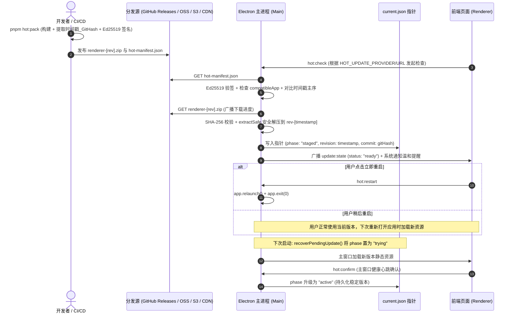

# Technical Design: 增量更新机制与多源发布链路

## 1. 架构总览与时序



---

## 2. 元数据契约与数据模型

### 2.1 清单文件结构 (`hot-manifest.json`)

```typescript
export interface HotManifest {
  revision: number; // 数字时间戳（如 20261029173000），用于大小比对
  versionTag: string; // 完整版本标识：时间戳_Git提交号 (如 "20261029173000_be18d80")
  commit: string; // Git Short SHA (如 "be18d80")，用于追溯排查
  compatibleApp: string; // 兼容的 Electron 大版本 (如 "0.1.1")
  url: string; // ZIP 下载绝对或相对路径
  sha256: string; // ZIP 文件的 SHA-256 哈希
  provider?: "github" | "oss" | "s3" | "generic";
  signature: string; // Base64 或 Hex 的 Ed25519 数字签名
}
```

### 2.2 运行时状态指针 (`userData/renderer-updates/current.json`)

```typescript
export interface HotPointer {
  revision: number; // 生效的时间戳主序
  versionTag: string; // 完整版本号标签 (时间戳_GitHash)
  commit: string; // Git Hash
  directory: string; // 实际解压目录 (如 "rev-20261029173000")
  previous: string | null; // 备用回滚目录
  compatibleApp: string;
  phase: "staged" | "trying" | "active";
}
```

---

## 3. 多源分发适配器设计

针对 `HOT_UPDATE_PROVIDER`，统一由 `HotUpdateSource` 解析器处理：

- **`generic` / `oss` / `s3`**：直接请求 `HOT_UPDATE_URL` 获取 `hot-manifest.json`，ZIP 包根据 URL 解析下载。
- **`github`**：`HOT_UPDATE_URL` 若为仓库简写（如 `pure-hearts/electron-starter`），自动解析为 GitHub Releases Latest Asset 的下载地址。

---

## 4. IPC 通道扩展

在 `src/shared/ipc.ts` 扩展：

```typescript
export interface HotUpdateInfo {
  currentRevision: number;
  currentVersionTag: string;
  currentCommit: string;
  phase: "none" | "staged" | "trying" | "active";
  previousDirectory: string | null;
  activeDirectory: string;
}

export interface IpcChannels {
  "hot:check": { args: []; result: HotUpdateResult };
  "hot:state": { args: []; result: HotUpdateInfo };
  "hot:restart": { args: []; result: void };
  "hot:confirm": { args: []; result: void };
}
```

---

## 5. 安全沙箱与崩溃保护

1. **解压遍历防御（Zip-Slip）**：严格限制解压目录路径，对任意带 `..` 或超出目标文件夹的文件抛出安全异常。
2. **私钥隔离**：私钥仅用于 `scripts/pack-hot.ts` 构建时签名，绝对禁止随客户端分发；开发环境提供 `pnpm hot:keygen` 快速生成本地测试证书。
3. **自愈机制**：若应用在 `phase: "trying"` 下非正常退出，下次启动时立即回滚至 `previous` 目录，并从磁盘安全清理异常版本。
