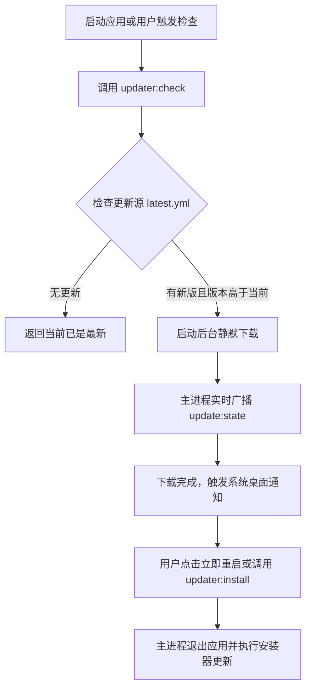

# 整包全量更新 (Full Update)

## 1. 概述与适用场景

当应用涉及以下改动时，必须通过**整包全量更新**覆盖安装整个应用程序：

1. 主进程（`src/main`）或预加载脚本（`src/preload`）的代码改动；
2. 引入了新的 npm 生产依赖或 Node 原生 C++ 扩展；
3. Electron 底座内核或 Chromium / Node 版本升级；
4. 操作系统层面的协议关联（Deep Link）、文件关联、服务注册或安装器打包脚本变动。

本项目集成了 `electron-updater` 与 GitHub Releases 机制，支持静默下载、进度通知与一键退出覆盖安装。

---

## 2. 架构设计与升级流程



---

## 3. 安全与升级门禁 (Upgrade Gate)

为确保在生产环境的稳定可靠，更新模块内置了以下防范机制：

1. **版本降级防范（Anti-Downgrade）**：
   - 比较 SemVer 语义化版本号，严格禁止低版本覆盖高版本，防止回退导致本地数据库或配置文件 Schema 损坏。
2. **重试机制与状态熔断（Gate Invalidation）**：
   - 在网络中断、下载损坏或用户反复点击更新时，模块会自动重置失效的临时文件，限制最大重试次数，杜绝死锁与重放攻击。
3. **平台安装器差异化行为**：
   - **Windows**：NSIS 静默/向导覆盖安装，支持自动关闭正在运行的互斥进程；
   - **macOS**：通过 Squirrel.Mac 或 ZIP 替换应用包（App Bundle）；
   - **Linux**：支持 AppImage 就地替换升级，以及提供 `.deb` 手动下载链接。

---

## 4. 相关 IPC 契约接口

前端通过 `window.$ipcBridge` 与更新模块交互：

```typescript
// 1. 检查是否存在整包新版本
const info = await window.$ipcBridge.invoke("updater:check");

// 2. 监听下载进度与安装就绪事件
const unsubscribe = window.$ipcBridge.on("update:state", (state) => {
  console.log(`更新状态: ${state.status}, 进度: ${state.percent}%`);
  if (state.status === "downloaded") {
    // 提示用户新版本已就绪
  }
});

// 3. 安装并立即重启
await window.$ipcBridge.invoke("updater:install");

// 在组件卸载时移除监听
unsubscribe();
```

---

## 5. 环境变量与发布配置

可以在 `.env.production` 或构建流水线中配置更新地址：

- `APP_UPDATE_URL`：指定更新清单（`latest.yml` / `latest-mac.yml`）所在的服务器根地址；
- 默认采用 `electron-builder.yml` 中的 GitHub 发布源（`provider: github`, `owner: pure-hearts`, `repo: electron-starter`）。

---

## 6. 源码导读

- **核心管理器**：`src/main/modules/update/full/index.ts`
- **重试门禁与状态保护**：`src/main/modules/update/full/gate.ts`
- **单测用例**：`tests/updater/updater-lifecycle.test.ts` 与 `tests/updater/update-gate.test.ts`
