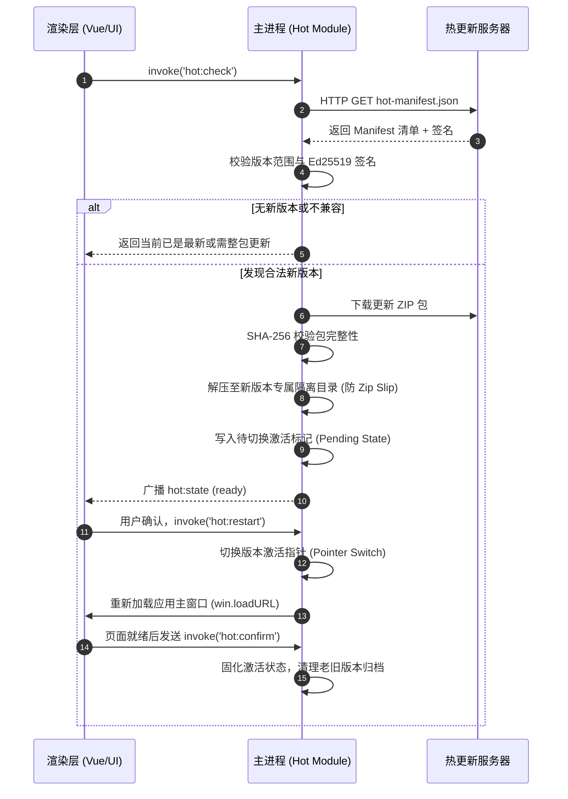

# 渲染层资源热更新 (Hot Update)

## 1. 概述与核心边界

`electron-starter` 提供了针对纯渲染进程（Vue 3 前端静态资源）的增量热更新机制。用户无需下载几十至上百兆的整包安装包，即可在数秒内静默更新前端界面与交互逻辑。

> [!IMPORTANT]
> **热更新安全边界声明**：
>
> - **允许更新范围**：仅限 `dist/renderer/` 下的 HTML、JS、CSS、图片等静态资源。
> - **绝对禁止更新范围**：不得替换主进程（`main`）、预加载脚本（`preload`）、Node 原生 C++ 扩展或依赖。如果涉及主进程修改，必须走[整包全量更新](./full-update.md)。

---

## 2. 架构设计与更新流程

热更新从检测到生效的时序流程如下：



---

## 3. 安全防护与核心实现

### 3.1 清单结构与 Ed25519 防篡改签名

热更新清单文件 `hot-manifest.json` 示例：

```json
{
  "version": "1.1.0",
  "minAppVersion": "0.1.0",
  "maxAppVersion": "0.9.9",
  "url": "https://releases.example.com/hot/v1.1.0.zip",
  "sha256": "8f4e2...6a7b",
  "signature": "d7a8f...3c91"
}
```

- **版本区间门禁**：通过 `minAppVersion` 与 `maxAppVersion` 限制当前安装包底座所能加载的前端代码范围，防止底层 IPC 不兼容导致界面崩溃。
- **Ed25519 非对称签名**：打包时使用私钥签名清单哈希；客户端硬编码公钥进行签名验签，中间人即使劫持网络请求也无法伪造更新包。

### 3.2 解包安全与 Zip Slip 路径穿越防御

在解压更新包时，主进程采用流式写入并对解压路径执行严格校验：

- 拒绝包含 `../`、`..\` 或绝对路径的危险压缩包条目；
- 解压后校验文件哈希与大小，杜绝解压炸弹。

### 3.3 崩溃自愈与版本自动回滚 (Rollback)

为防止前端更新后引入白屏或未捕获的致命 JavaScript 错误：

1. 激活新版本后，主进程将状态置为 `pending_confirm`；
2. 页面成功挂载后，渲染层调用 `window.$ipcBridge.invoke("hot:confirm")`；
3. 若新版本加载中发生致命崩溃、渲染进程异常退出，或在设定超时时间（默认 10 秒）内未收到确认信号，主进程在下次启动时自动回滚版本指针至上一个稳定版本。

---

## 4. 相关 IPC 契约接口

前端通过 `window.$ipcBridge` 与热更新模块交互：

```typescript
// 1. 手动触发检查更新
const result = await window.$ipcBridge.invoke("hot:check");

// 2. 查询当前热更新状态
const state = await window.$ipcBridge.invoke("hot:state");
// state 包含: { status: 'idle' | 'checking' | 'downloading' | 'ready' | 'error', version?: string }

// 3. 立即重启应用以应用就绪的热更资源
await window.$ipcBridge.invoke("hot:restart");

// 4. 确认新版本正常启动（防止异常回滚）
await window.$ipcBridge.invoke("hot:confirm");
```

---

## 5. 源码导读

- **核心管理器**：`src/main/modules/update/hot/index.ts`
- **签名校验与安全解压**：`src/main/modules/update/hot/archive.ts` 与 `manifest.ts`
- **版本指针与垃圾回收 (GC)**：`src/main/modules/update/hot/pointer.ts`
- **GitHub Actions 发布工作流**：`.github/workflows/hot-release.yml`
