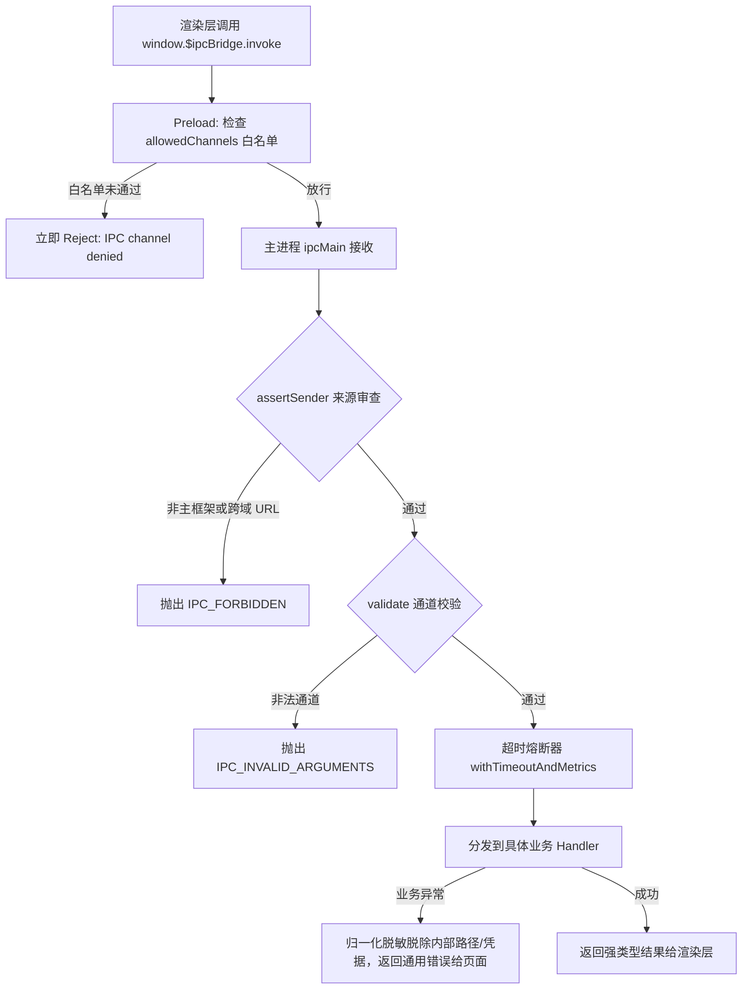

# 类型安全 IPC 通信与 Preload 安全隔离

## 1. 核心设计原则

在 Electron 应用中，渲染进程通常被视为不可信环境。为彻底杜绝远程代码执行（RCE）与恶意注入，本项目遵循以下安全准则：

1. **禁用 Node 集成**：`nodeIntegration: false`，彻底禁止渲染层直接 `require()` Node 原生模块。
2. **启用上下文隔离**：`contextIsolation: true` 与 `sandbox: true`。
3. **最小特权桥接**：Preload 脚本仅通过 `contextBridge.exposeInMainWorld` 挂载一个受限且强类型的对象 `window.$ipcBridge`，严禁暴露原始的 `ipcRenderer` 实例。
4. **双向白名单准入**：仅放行预定义的请求通道与事件订阅。
5. **调用来源合法性审查**：主进程校验 `senderFrame`，拒绝非主窗口或跨域 iframe 的请求。

---

## 2. 桥接 API: `window.$ipcBridge`

Preload 仅暴露以下两个强类型方法：

```typescript
export interface DesktopBridge {
  /** 双向请求/响应：invoke('channel', ...args) */
  invoke<C extends InvokeChannel>(channel: C, ...args: InvokeArgs<C>): Promise<InvokeResult<C>>;

  /** 单向主进程推送订阅：on('channel', (payload) => void)，返回精确的取消订阅函数 */
  on<E extends EventChannel>(channel: E, callback: (payload: DesktopEvents[E]) => void): () => void;
}
```

### 示例用法

```typescript
// 1. 发起双向异步调用
const version = await window.$ipcBridge.invoke("app:version");
await window.$ipcBridge.invoke("store:set", "theme", "dark");

// 2. 订阅主进程事件并安全解绑
const stopListening = window.$ipcBridge.on("download:state", (state) => {
  console.log(`下载任务 ${state.id}: ${state.percent}%`);
});

// 组件卸载时释放监听器，防止内存泄漏
onUnmounted(() => {
  stopListening();
});
```

---

## 3. 白名单准入与运行时校验 (`validation.ts`)

为了平衡安全性与业务扩展的灵活性，系统的 IPC 校验机制如下：

1. **白名单集合**：
   - `allowedChannels`：所有合法双向请求通道的集合（如 `app:quit`、`download:start` 等）；
   - `allowedEvents`：所有合法单向系统事件的集合（如 `download:state`、`theme:system:changed` 等）。
2. **准入网关 `validate(channel)`**：
   - 校验传入的 `channel` 是否存在于 `allowedChannels` 或 `allowedEvents` 白名单中；
   - 只要属于白名单通道或事件即可放行，参数的具体业务约束交由具体模块自行负责或由 TypeScript 类型体系提供静态保障；
   - 任何不在白名单内的未知或危险通道一律抛出异常拒绝。

---

## 4. 主进程安全网关与异常脱敏

在 `src/main/ipc/index.ts` 中，所有 IPC 请求均经过统一网关调度：



### 异常归一化脱敏

底层由于文件系统或网络 SDK 抛出的异常（可能包含本地文件绝对路径、认证凭据等敏感信息）均在主进程被记录到脱敏日志中；返回给页面的仅为标准化错误码（如 `IPC_OPERATION_FAILED`），防止信息泄漏。

---

## 5. Web 模式双端兼容 (WebShim)

为了支持纯浏览器调试与轻量化 Web 模式部署，项目在 `src/renderer/shims/web-bridge.ts` 中实现了一套纯前端内存 Mock 桥接层：

- 当检测到运行在纯浏览器环境（`!window.$ipcBridge`）时，自动注入内存版本 Mock 实现；
- 所有常用配置读写、下载状态模拟、全量更新均支持在浏览器内顺畅运行。

---

## 6. 源码导读

- **IPC 类型契约声明**：`src/shared/ipc.ts`
- **通道白名单与验证**：`src/shared/validation.ts`
- **Preload 桥接实现**：`src/preload/index.ts`
- **主进程请求分发与安全网关**：`src/main/ipc/index.ts` 与 `src/main/ipc/origin.ts`
- **Web 模式垫片**：`src/renderer/shims/web-bridge.ts`
