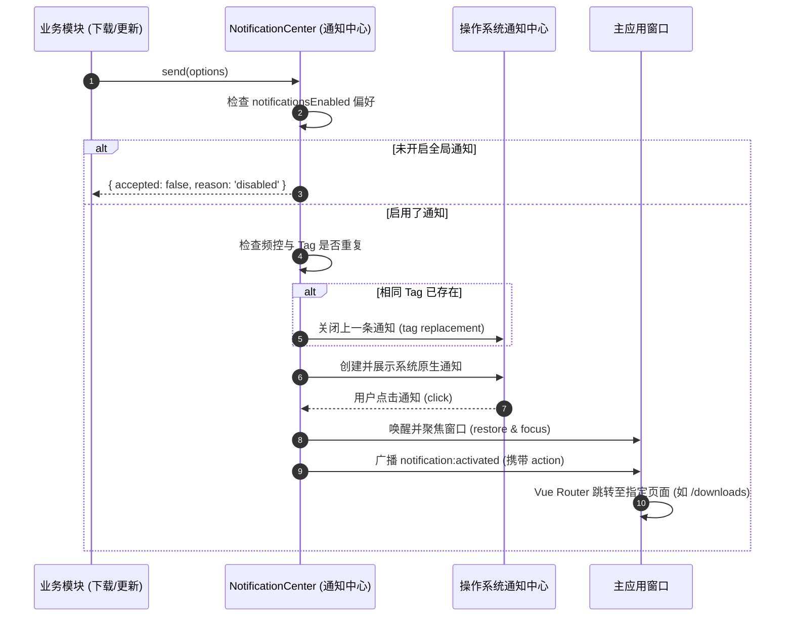

# 桌面系统通知系统 (Notification System)

## 1. 概述与核心能力

桌面通知是用户获取即时状态（如任务完成、新版本就绪、告警提醒）的重要渠道。`electron-starter` 针对原生 Electron `Notification` 进行了健壮性封装，提供了防骚扰、易交互的生产级通知中心：

- **10 秒防刷屏频控（Rate Limiting）**：限制高频连续弹窗，保护用户专注度；
- **Tag 就地替换覆盖**：相同 `tag` 的通知（如“下载进度更新”）直接在系统通知栏就地更新内容并关闭前一条，同时绕过 10 秒频控限制；
- **智能静音判断**：主窗口处于活动并聚焦状态时，自动静音以防干扰用户正在进行的操作；
- **深度业务路由联动**：用户点击系统通知时，自动恢复并聚焦应用窗口，同时派发带自定义 `action` 路由的事件。

---

## 2. 架构设计与通知生命周期



---

## 3. 核心配置与选项模型

发送通知的核心参数接口定义在 `src/shared/notification.ts`：

```typescript
export interface NotificationOptions {
  title: string; // 标题（1~128 字符）
  body: string; // 正文内容（1~1000 字符）
  kind?: "info" | "success" | "warning" | "error"; // 通知类型
  tag?: string; // 标识符，同 tag 自动覆盖
  icon?: string; // 自定义图标路径，默认采用应用图标
  action?: string; // 点击后跳转的应用内路由（如 /downloads）
  dedupeKey?: string; // 去重防抖键
}
```

---

## 4. 相关 IPC 契约接口

前端通过 `window.$ipcBridge` 发送通知或监听交互：

```typescript
// 1. 发送高级业务通知
await window.$ipcBridge.invoke("notification:send", {
  title: "文件下载完成",
  body: "electron-starter-v1.0.0.zip 已保存至下载目录",
  kind: "success",
  tag: "download:task-123",
  action: "/downloads",
});

// 2. 发送简易标题+内容通知
await window.$ipcBridge.invoke("notification:show", "提示", "操作成功完成");

// 3. 查询当前操作系统是否支持原生通知
const supported = await window.$ipcBridge.invoke("notification:capabilities");

// 4. 监听通知点击与激活事件
const unsubscribe = window.$ipcBridge.on("notification:activated", (payload) => {
  console.log("用户点击了通知:", payload.action);
  if (payload.action) {
    router.push(payload.action);
  }
});
```

---

## 5. 源码导读

- **通知中心调度器**：`src/main/modules/notification/center.ts`
- **Electron 原生适配器**：`src/main/modules/notification/index.ts`
- **通知数据结构**：`src/shared/notification.ts`
- **单测用例**：`tests/system/notification-center.test.ts`
