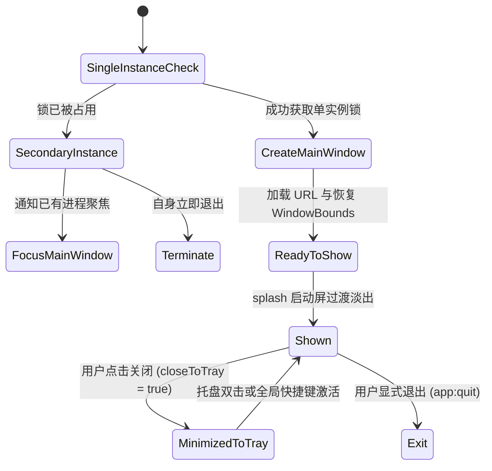

# 窗口生命周期与系统托盘 (Window & Tray)

## 1. 概述与核心能力

桌面应用区别于普通 Web 网页的关键在于窗口控制和原生托盘常驻能力。`electron-starter` 实现了商业客户端标准的窗口体验：

- **单实例互斥锁**：防止用户多次双击启动重复进程，第二次启动自动呼出已存在的主窗口；
- **跨平台自绘无边框标题栏**：完美适配 macOS 交通灯原生避让，以及 Windows/Linux 原生风格最小化、最大化与关闭按钮组；
- **窗口几何状态自动持久化**：退出或移动后自动记忆窗口尺寸、坐标和最大化状态，防越界自愈；
- **系统托盘（Tray）**：支持托盘常驻、双击呼出主窗口、托盘上下文右键菜单与“关闭至托盘”模式切换。

---

## 2. 窗口架构与状态机



---

## 3. 自绘无边框标题栏 (`TitleBar.vue`)

为保证整体现代暗黑/科技感视觉一致性，主窗口采用 `frame: false` 无边框模式：

1. **拖拽区域隔离**：
   - 标题栏背景容器应用 CSS 样式 `-webkit-app-region: drag`，支持拖拽移动窗口；
   - 交互按钮（搜索、导航、设置、窗口控制按钮组）必须显式标记 `-webkit-app-region: no-drag`，否则会导致无法响应点击。
2. **多平台差异适配**：
   - **macOS**：隐藏自绘控制按钮，自动留出左侧 72px 交通灯区域，与系统原生红绿黄按钮融合；
   - **Windows / Linux**：右侧渲染高保真最小化、最大化/还原、关闭按钮组。
3. **双击标题栏最大化/还原**：
   - 监听标题栏双击事件，调用 `window:action` (`maximize` / `restore`)。

---

## 4. 窗口位置记忆与安全防越界

窗口关闭或尺寸变更时，主进程将尺寸与坐标序列化持久化至 `windowBounds`：

```json
{ "x": 100, "y": 80, "width": 1200, "height": 800, "isMaximized": false }
```

- **异常越界自愈**：当用户拔掉外接显示器或分辨率发生剧变时，`normalizeWindowBounds()` 会校验坐标是否完全脱离可见工作区；若不可见则自动重置居中显示，杜绝窗口“在屏幕外隐身”的常见缺陷。

---

## 5. 系统托盘管理 (`tray.ts`)

- **托盘菜单项**：
  - “显示主窗口”
  - “设置中心”
  - “检查更新”
  - 分割线与“退出应用”
- **关闭行为（`closeToTray`）**：
  - 若用户在设置中心开启“关闭主窗口时最小化到托盘”，点击关闭仅触发 `win.hide()`；
  - 只有在托盘菜单点击“退出应用”或调用 `app:quit` 时才彻底终结进程。

---

## 6. 相关 IPC 契约接口

前端通过 `window.$ipcBridge` 与窗口管理模块交互：

```typescript
// 1. 触发窗口操作
await window.$ipcBridge.invoke("window:action", "minimize");
await window.$ipcBridge.invoke("window:action", "maximize");
await window.$ipcBridge.invoke("window:action", "restore");
await window.$ipcBridge.invoke("window:action", "close");

// 2. 查询当前窗口是否已最大化
const isMax = await window.$ipcBridge.invoke("window:isMaximized");

// 3. 监听最大化状态变化（用于更新自绘标题栏按钮图标）
const unsubscribe = window.$ipcBridge.on("window:maximize-change", (maximized) => {
  isMaximized.value = maximized;
});

// 4. 打开新的独立应用子窗口
await window.$ipcBridge.invoke("window:open", "/settings");
```

---

## 7. 源码导读

- **主窗口创建与生命周期**：`src/main/window.ts`
- **窗口尺寸持久化策略**：`src/main/modules/system/window-bounds-policy.ts`
- **托盘管理器**：`src/main/modules/system/tray.ts`
- **前端自绘标题栏组件**：`src/renderer/components/TitleBar.vue`
